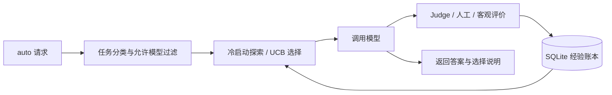

# ModelRouter + RSL

ModelRouter 是一个提供 OpenAI 兼容聊天接口的模型路由服务。本项目基于 [ModelRouterCourse](https://github.com/NewYearEve-Godsheep/ModelRouterCourse)，在原有模型调用、管理和级联能力上加入 Recursive Self-Learning（RSL）反馈学习闭环。

系统按任务类别记录模型的回答质量、费用和耗时，并利用历史反馈选择后续 `model=auto` 请求的候选模型。RSL 调整的是路由策略，不修改底层大模型参数。

## 功能

- OpenAI 兼容聊天接口，支持显式模型调用与自动路由。
- 按任务类别进行冷启动探索和 UCB 风格选择。
- 使用 SQLite 持久化经验，按 routing profile 隔离统计与策略。
- 支持模型 Judge、人工反馈和客观答案评分，未评价结果保持待评价状态。
- 提供反馈明细、统计和只读路由预览，返回模型选择依据。
- 保留上游 provider、模型管理、关键词/语义路由和 cascade 能力。
- 支持 DeepSeek 非思考模式，以及可选 JSON 结构化输出。
- 提供离线演示、自动测试、模拟评测和受预算限制的真实 API 评测工具。

## 工作流程



按 `profile + category + model` 聚合统计。五类任务为 coding、math、translation、writing、general。

```text
S = wq × 平均质量 − wc × min(平均费用/C, 1)
    − wl × min(平均延迟/L, 1) + we × sqrt(2 ln(N+2)/(n+1))
```

- `n` 为该模型有效评分数，`N` 为当前候选模型有效评分总数。
- 每个候选模型先获得至少 `rsl_min_samples` 次尝试，之后按分数选择。
- 冷启动质量先验为 0.5；成本先用输入长度和定价估计，再用历史实际每请求费用。
- 固定尺度 `C`、`L` 保持不同候选集之间的成本/延迟含义稳定。
- 人工纠正替代该次自动评分，不增加样本数量，不改变实际费用。
- Judge 出错、返回非法分数或未配置时，质量为空，等待人工反馈。

这是一种**任务条件化的在线统计学习**。Recursive 指“本轮经验改变下一轮选择”的循环，不意味着算法自动重写自身或训练大模型。

## 环境要求

- Python 3.11–3.13。
- SQLite（通过 Python 标准库使用）。
- 真实调用需要有效的上游服务及 API key；离线测试和模拟不需要密钥。

Python 3.11–3.13。以下命令在项目根目录执行。

Windows PowerShell：

```powershell
python -m venv .venv
.\.venv\Scripts\python -m pip install -r requirements-lock.txt
.\.venv\Scripts\Activate.ps1
```

若 PowerShell 不允许激活，无需修改系统策略；将后文 `python` 换成 `.\.venv\Scripts\python` 即可。

macOS / Linux：

```bash
python3 -m venv .venv
source .venv/bin/activate
python -m pip install -r requirements-lock.txt
```

`requirements-lock.txt` 固定本次验证的依赖版本；`requirements.txt` 列出直接依赖范围。语义嵌入是上游可选功能，本作业的 RSL 无需下载嵌入模型。

## 快速开始

### 1. 配置并启动服务

复制 `.env.example` 为 `.env`，填写上游密钥和两个自行设置的本地鉴权密钥。以本次 DeepSeek 接入为例：

```dotenv
OPENAI_BASE_URL=https://api.deepseek.com
OPENAI_KEY_1=YOUR_DEEPSEEK_API_KEY
ROUTER_INTERNAL_API_KEY=YOUR_LOCAL_RUNTIME_SECRET
ADMIN_API_KEY=YOUR_LOCAL_ADMIN_SECRET
ROUTER_CONFIG=config/deepseek.yaml
```

其余设置保留模板。`config/deepseek.yaml` 将 Flash 映射为 `budget`、Pro 映射为 `strong`。模型名称、价格为本次实验快照，后续复现需确认供应商仍支持这些模型。其他供应商使用 `config/providers.yaml` 并调整模型和价格。

```bash
python -m app.main
```

默认地址 `http://127.0.0.1:8000`；浏览器打开 `/docs` 可查看并操作 API，`/health` 检查服务状态。

配置只在空数据库首次启动时导入。已有数据库请通过管理 API 修改 provider / model，或使用一个新的 `ROUTER_DB` 路径。不要为了更新配置删除已有实验数据。

### 2. 创建 RSL profile 并发送请求

下面以 PowerShell 为例创建学习 profile。先把密钥替换为 `.env` 中的值：

```powershell
$adminHeaders = @{Authorization = 'Bearer YOUR_ADMIN_KEY'}
$policy = @{
  rsl_enabled = $true
  rsl_min_samples = 3
  rsl_quality_weight = 1.0
  rsl_cost_weight = 0.2
  rsl_latency_weight = 0.1
  rsl_exploration_weight = 0.15
  rsl_cost_scale = 0.01
  rsl_latency_scale_ms = 5000
  allowed_models = @('budget', 'strong')
  keyword_routing_enabled = $false
  semantic_routing_enabled = $false
  cascade_enabled = $false
}
$body = @{name='rsl-coursework'; config_json=($policy | ConvertTo-Json -Compress)} | ConvertTo-Json
$profile = Invoke-RestMethod http://127.0.0.1:8000/admin/routing-profiles -Method Post -Headers $adminHeaders -ContentType 'application/json' -Body $body
$runtimeHeaders = @{Authorization='Bearer YOUR_INTERNAL_KEY'; 'X-Routing-Profile-Id'=[string]$profile.id}
$question = @{model='auto'; messages=@(@{role='user'; content='Calculate 17+28. Return only the integer.'})} | ConvertTo-Json -Depth 5
$answer = Invoke-RestMethod http://127.0.0.1:8000/v1/chat/completions -Method Post -Headers $runtimeHeaders -ContentType 'application/json' -Body $question
$answer | ConvertTo-Json -Depth 12
```

### 3. 提交反馈

以上 profile 未配置 Judge，回答标为 `pending`，需人工/客观评价才能学习质量。提交真实评价示例：

```powershell
# 仅当答案已核实正确时使用 score=1.0；错误使用 0.0。
$feedback = @{attempt_id=$answer.rsl.attempts[0].id; score=1.0; reason='Verified against the reference answer'} | ConvertTo-Json
Invoke-RestMethod http://127.0.0.1:8000/admin/rsl/feedback -Method Post -Headers $adminHeaders -ContentType 'application/json' -Body $feedback
Invoke-RestMethod "http://127.0.0.1:8000/admin/rsl/stats?routing_profile_id=$($profile.id)" -Headers $adminHeaders
```

自动评价：将 `rsl_judge_model` 配成已注册且在允许列表内的模型路由键，例如 `strong`。Judge 使用普通上游调用，也产生费用。如配置单独的 `judge` 路由，可用 `recommendation_excluded_models: ["judge"]` 排除其回答候选身份；它仍必须在 `allowed_models` 中。

## RSL 参数

| profile 字段 | 默认值 | 意义 |
|---|---:|---|
| rsl_enabled | false | 开关 |
| rsl_judge_model | null | Judge 路由键；必须在允许集合中 |
| rsl_min_samples | 3 | 每候选、每类别的最低初始尝试数 |
| rsl_exploration_weight | 0.15 | 探索系数 |
| rsl_quality_weight | 1.0 | 质量权重 |
| rsl_cost_weight | 0.2 | 生成费用惩罚 |
| rsl_latency_weight | 0.1 | 生成延迟惩罚 |
| rsl_cost_scale | 0.01 | 每请求费用归一化尺度，所有价格使用一致币种 |
| rsl_latency_scale_ms | 5000 | 延迟归一化尺度 |
| rsl_quality_threshold | 0.7 | RSL 级联接受阈值 |

profile 创建/修改时验证 JSON 和 RSL 参数，拒绝负权重、无效尺度和非有限数字。原配置中其他上游字段继续兼容。

## 查看路由与反馈

| 接口 | 用途 |
|---|---|
| `POST /v1/chat/completions` | `model=auto` 且 profile 启用 RSL 时使用学习路由 |
| `POST /admin/rsl/preview` | 查看候选评分，不调用模型、不更新数据 |
| `GET /admin/rsl/stats?routing_profile_id=1` | 分类聚合统计 |
| `GET /admin/rsl/feedback?routing_profile_id=1` | 尝试明细与人工纠正 |
| `POST /admin/rsl/feedback` | 通过 `attempt_id` 修正质量分数 |
| `POST /admin/routing-profiles` | 创建独立策略与实验范围 |

管理接口需管理员密钥。请求与反馈示例见下方运行步骤。

行为边界：

- 显式指定模型、ensemble 或关闭 RSL 时保留原流程；这些请求不写 RSL 账本。
- RSL 选择优先于关键词、语义和原推荐器；仍受允许/禁用模型及不可用状态限制。
- RSL 级联从学习选中的模型开始，再尝试配置链中的可用模型，每步独立记账。
- RSL 的 `stream=true` 为**先完成并评价，再输出 SSE**，不是逐 token 低延迟直播。非 RSL 流式路径保持原实现。
- Judge 费用独立记录；缺失用量或失败请求费用保持未知。`known_total_cost` 是已知部分，须结合 `cost_complete` 阅读。
- 适配器内部重试的独立账单不可见，无法保证与供应商账单完全一致。
- RSL 使用独立账本，普通 `/admin/usage` 不包含这些请求；请使用 `/admin/rsl/*`。

## 结构化输出

聊天请求新增 `response_format`，支持 `text` 和 `json_object`。OpenAI 兼容和 DeepSeek 适配器向上游传递该参数，未设置时保留原行为。示例：

```json
{
  "model": "auto",
  "messages": [{"role": "user", "content": "Calculate 17+28. Return a JSON object with one integer field named answer, for example {\"answer\":0}."}],
  "response_format": {"type": "json_object"},
  "thinking": {"type": "disabled"},
  "temperature": 0,
  "max_tokens": 256
}
```

`experiments/structured_answers.py` 在评测端生成不含参考答案的格式提示，严格验证单个 `answer` 字段及值类型，再转换为原评分器接受的整数/数组。它不会自动改写所有线上请求，也不会从解释文字中猜测正确答案。

## 验证与结果

### 未接入真实 API：离线演示与模拟

```bash
python -m unittest discover -s tests -v
python -m examples.offline_demo
python -m experiments.simulate
```

本地 37 项测试通过。离线演示使用确定性替身模型，经真实 FastAPI 路由、认证和 SQLite 展示“调用—评价—更新选择”的闭环，不产生 API 费用。

模拟采用 5 个随机种子，每个种子包含 600 条训练和 300 条独立测试请求。测试时冻结策略，各策略共享同一组预生成结果：

| 策略 | 平均质量 | 每请求模拟费用 | 平均耗时/ms | 综合效用 |
|---|---:|---:|---:|---:|
| 默认 budget | 0.582 | 0.00050 | 200 | 0.568 |
| 固定强模型 | 0.965 | 0.01000 | 3000 | 0.705 |
| 轮询 | 0.775 | 0.00450 | 1367 | 0.658 |
| 冻结 RSL | 0.967 | 0.00450 | 1367 | 0.850 |

在设定的任务分工和可靠反馈条件下，RSL 获得更高综合效用。模型成功概率、费用和耗时均为人工设定，不能解释为真实模型效果；每个种子的 RSL 训练还产生约 2.773 的模拟费用。完整配置、标准差和学习曲线见 [模拟结果数据](artifacts/simulation/results.json)。

### 已接入真实 API：DeepSeek 验证

真实评测使用 `deepseek-flash`（budget）和 `deepseek-v4-pro`（strong），关闭思考，`temperature=0`，输出上限 256 token。任务包括数学取模、代码执行结果和记录筛选排序，参考答案由程序计算。测试前冻结路由，测试答案不回写训练数据。

**路由效果**（48 道训练题、24 道独立测试题，两模型配对测量）：

| 策略 | 正确题数 | 任务成功率 | 测试费用估算/元 | 平均模型耗时/ms |
|---|---:|---:|---:|---:|
| 固定 Flash | 7/24 | 29.2% | 0.024234 | 994 |
| 固定 Pro | 4/24 | 16.7% | 0.071442 | 1520 |
| 冻结 RSL | 4/24 | 16.7% | 0.025881 | 917 |

RSL 与固定 Pro 的正确题数相同，测试费用估算降低约 63.8%，但没有超过固定 Flash。成功率按答案及输出格式严格评分，格式违规和截断也会计为失败。

**可选结构化输出效果**（18 道训练题、9 道独立测试题，同一冻结路由下配对比较）：

| 配置 | 正确题数 | 测试费用估算/元 | 平均模型耗时/ms | 截断次数 |
|---|---:|---:|---:|---:|
| Flash 普通输出 | 3/9 | 0.009758 | 969 | 3 |
| Flash 结构化输出 | 3/9 | 0.003614 | 701 | 0 |
| RSL 普通输出 | 3/9 | 0.014948 | 1028 | 3 |
| RSL 结构化输出 | 2/9 | 0.010385 | 775 | 0 |

结构化输出下，RSL 的费用估算降低 30.5%、平均耗时降低 24.5%、截断降为 0，但正确数从 3/9 降至 2/9；固定 Flash 则在正确数相同时降低了费用与耗时。因此该能力保持可选，不能据此声称 RSL 准确率或整体性能提升。两个测试集不同，不跨表直接比较准确率；耗时受网络、缓存和服务负载影响。

已完成 150 次实验调用，费用按实验时峰时缓存未命中价格保守估算共 0.238133 元，不含连通性检查；实际扣款以供应商为准。详细题目、原始响应、用量和完整对照保存在 [RSL 评测数据](artifacts/deepseek_real/results.json) 与 [结构化输出评测数据](artifacts/deepseek_structured/results.json)。

### 运行真实评测

配置 `.env` 后，以下命令仅显示实验计划：

```bash
python -m experiments.run_deepseek
python -m experiments.run_structured
```

添加 `--execute` 才会实际调用 API 并产生费用。每次使用新的输出目录；工具共享累计预算账本，失败不自动重试，不应删除账本来绕过额度。

```bash
python -m experiments.run_deepseek --execute --output runs/my-rsl-run
python -m experiments.report_deepseek --source runs/my-rsl-run --output artifacts/my-rsl-run

python -m experiments.run_structured --execute --output runs/my-structured-run
python -m experiments.report_structured --source runs/my-structured-run --output artifacts/my-structured-run
```

专用工具使用隔离数据库，通过应用路由访问真实上游，无需另启服务。输入、输出和累计预算均有上限。输入限制为单条用户消息、1800 UTF-8 字节以内，输出最多 256 token。

## 项目结构

```text
app/
  core/rsl.py                 学习选择与经验账本
  core/rsl_runtime.py         请求、评价与逐次记账
  api/admin/rsl.py            统计、反馈和预览接口
config/                      provider 与模型配置模板
examples/                    无密钥闭环演示
experiments/                 数据生成、模拟和真实评测工具
artifacts/                   公开实验数据与结果
  simulation/                未接入 API 的模拟结果
  deepseek_real/             真实 API 路由评测
  deepseek_structured/       真实 API 结构化输出评测
tests/                       单元与 API 集成测试
.github/workflows/           自动测试配置
```

## 使用边界

- 当前任务分类基于规则，质量估计依赖累计反馈，小样本或分布变化可能产生错误偏好。
- Judge 评分可能有偏差；真实评测优先使用客观参考答案。
- RSL 流式响应采用缓冲 SSE，不提供逐 token 首字延迟优势。
- RSL 账本与普通 usage 账本独立，费用估算不能替代供应商账单。
- 真实测试样本较小，尚未证明泛化优势或高并发性能。

## 项目来源

基于 [ModelRouterCourse](https://github.com/NewYearEve-Godsheep/ModelRouterCourse) 开发。本项目独立实现 RSL 经验账本、反馈接口和执行路径，并补充测试、评测工具及结构化输出支持。上游未提供 LICENSE，未擅自为上游代码指定许可证。


配置模板见 `.env.example`；真实 `.env`、数据库、虚拟环境及运行日志均不纳入版本管理。
